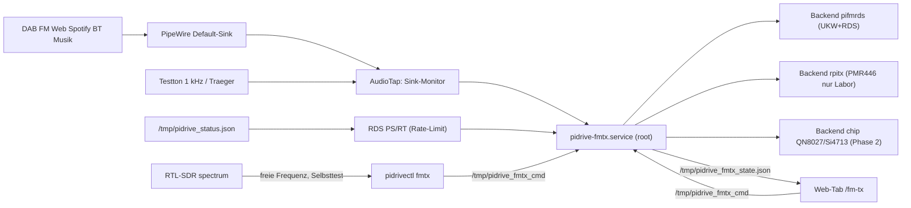

# Konzept: PiDrive FM-Sender (UKW + RDS, PMR446 nur Labor)

Stand: 2026-10-16 · Status: **implementiert, nicht hardware-getestet** (Lab-Gate E-1 offen)

PiDrive bekommt einen optionalen UKW-Sender. Der Takt kommt aus dem GPCLK-Ausgang
des Pi 4 (PiFmRds-Linie), RDS zeigt Sender und Titel. Gesendet wird entweder die
laufende Wiedergabe (Spiegel parallel zu Klinke/HDMI/BT/ESP) oder ein Testsignal
(1 kHz, Träger, Stille). PMR446 ist nur in der Betriebsart „Labor/Dummy-Load“
freigeschaltet. Ein externer FM/RDS-Chip (QN8027/Si4713 per I2C) ist als zweites
Backend vorbereitet.

## 1. Quellen (technology-audit)

| Quelle | Inhalt |
|---|---|
| `projects/pi-fm-tx/applications/rpi-gpio-fm-tx.md` | GPCLK-Signalpfad, Pi-Modelle, Pins, Fallstricke |
| `projects/pi-fm-tx/applications/fm-rds.md` | RDS-Unterträger, PS/RT, Control-Pipe (`EVID-RDS-2026-10-10-001..004`) |
| `projects/pi-fm-tx/applications/rpitx.md` | rpitx-Frequenzbereich, Pi-4-Beta, `gpu_freq=250` |
| `projects/esp-fm-rds-node/…`, `projects/esp-fm-tx/…` | Nachbarprojekte: ESP + QN8027/Si4713, APLL-FM |
| `artifacts/prompts/bootstrap-repo-*-20261010.md` | Pins der Upstream-Repos |

Gepinnte Upstreams (Build nur auf diesen Commits):

| Repo | Commit | Verwendung in PiDrive |
|---|---|---|
| ChristopheJacquet/PiFmRds | `2707ecc` | Backend `pifmrds` (UKW + RDS, Standard) |
| F5OEO/rpitx | `ee7ff57` | Backend `rpitx` (PMR446 nur Labor, Testträger) |
| markondej/fm_transmitter | `322500e` | nur Referenz (GPIO 21 als Compile-Option) |
| pifm (Original) | `6c30d00` | nur Referenz |

## 2. Signalpfad (FACT laut Audit)

1. Der BCM2711 erzeugt den HF-Takt über PLL und Fractional-Teiler des GPCLK0.
2. Die FM-Modulation entsteht durch DMA-gesteuertes Umschreiben des Teilers
   (Mailbox-/Uncached-Speicher). Root und `/dev/mem` sind nötig.
3. Das Ergebnis ist ein **3,3-V-Rechteck** am Taktpin, kein Sinus.
4. RDS: 57-kHz-Unterträger, interner Samplepfad ca. 228 kHz, Felder PI (16 bit),
   PS (8 Zeichen), RT (64 Zeichen). PiFmRds nimmt Live-Updates über eine
   Named Pipe (`-ctl`) entgegen: `PS …`, `RT …`, `TA ON|OFF`.

## 3. Grenzen

### 3.1 Frequenzen

| Band | Bereich | Raster | Backend | Hinweis |
|---|---|---|---|---|
| UKW | 87,50–108,00 MHz | 50 kHz | pifmrds, rpitx, chip | Pi 4: markondej empfiehlt < 93 MHz (Lab prüfen) |
| PMR446 | Kanal 1–16, f = 446,00625 + (n−1)·0,0125 MHz | 12,5 kHz | nur rpitx | **nur `mode=lab_dummy`** |

- rpitx nennt 5 kHz–1500 MHz; oberhalb von ca. 250 MHz fällt die Ausgangsleistung
  stark ab, die Signalqualität ist auf dem Pi 4 „beta“.
- Pi 5 (RP1) wird von keinem der Upstreams unterstützt. `freq_plan` blockiert
  den Start, wenn `/proc/device-tree/model` „Raspberry Pi 5“ meldet.

### 3.2 Sendepin

Der Pin ist **nicht frei wählbar**. Nur Pins mit GPCLK-Funktion kommen in Frage:

| Pin | Funktion | pifmrds | rpitx | markondej |
|---|---|---|---|---|
| GPIO 4 (Pin 7) | GPCLK0 ALT0 | ja (fest) | ja (fest) | ja |
| GPIO 20 / 32 / 34 | GPCLK0 ALT5/ALT0 | nein | nein | nein (nicht auf Header bzw. nicht unterstützt) |
| GPIO 21 (Pin 40) | GPCLK1 ALT5 | nein | nein | Compile-Option |

Die Web-UI und `pidrivectl fmtx pin` bieten nur die Pins an, die das gewählte
Backend in `capabilities()["pins"]` meldet. Mit den mitgelieferten Backends ist
das heute praktisch nur **GPIO 4**. GPIO 21 ist für einen späteren markondej-Build
vorgesehen.

### 3.3 Reichweite und Leistung

- Gemessene Werte gibt es in der KB noch nicht (UNKNOWN, Lab-Gate E-1).
- Ohne Antenne (nur Leiterbahn/Jumper): wenige Meter. Mit λ/4-Draht (~75 cm bei
  100 MHz) deutlich mehr — und damit klar über dem, was rechtlich zulässig ist.
- Für die Einspeisung ins Autoradio genügt eine sehr kurze Distanz bzw. eine
  Kabelverbindung mit Dämpfungsglied.

### 3.4 Rechtsrahmen (vor jedem Einsatz prüfen)

- UKW-Kleinstsender für Kfz-Audio laufen in DE/EU unter den SRD-Regeln
  (Allgemeinzuteilung der BNetzA, ERC/REC 70-03, Anhang „Non-specific SRD“ bzw.
  „Low power FM transmitters“). Die Größenordnung ist **50 nW ERP** —
  **genauen Grenzwert und aktuelle Fassung vor Nutzung prüfen**.
- Ein GPIO mit Antenne liegt in der Regel weit darüber und erzeugt zusätzlich
  Oberwellen außerhalb des Bandes. Deshalb: Antennenbetrieb nur nach Lab-Gate
  und mit Tiefpass, sonst Kabel oder Dummy-Load.
- **PMR446 aus einem Pi-GPIO ist nicht zulässig** (PMR446 verlangt zugelassene
  Geräte mit fest angebauter Antenne, 500 mW ERP). PiDrive bietet PMR446 nur für
  einen geschirmten Laboraufbau mit Dummy-Load an.
- Die Verantwortung für Antenne, Leistung und Rechtslage liegt beim Betreiber.
  PiDrive speichert dafür einen Consent-Zeitstempel (`fm_tx.consent_ts`).

### 3.5 Oberwellen und DAB-Konflikt

- Rechteckträger ⇒ ungerade Harmonische stark, gerade durch Tastverhältnis-Fehler
  ebenfalls vorhanden.
- **2. Harmonische von 87,5–108 MHz = 175–216 MHz ⇒ DAB-Band III**
  (Kanäle 5A–10D), das PiDrive selbst empfängt. Die 3. Harmonische liegt bei
  262,5–324 MHz.
- `freq_plan.harmonics_conflicts()` meldet für jede Frequenz, welche
  DAB-Blöcke (174,928–239,200 MHz, ±1 MHz) von der 2./3. Harmonischen getroffen
  werden, und markiert den aktuell gespielten DAB-Kanal als Blocker.
- **Tiefpass am Pin ist Pflicht bei Antenne** (z. B. 7-poliger LC-Tiefpass,
  fg ≈ 110 MHz). Ohne Tiefpass ist paralleler DAB-Empfang gestört.

### 3.6 Konflikte am Pi

| Konflikt | Wirkung | Maßnahme in PiDrive |
|---|---|---|
| Analoge Klinke (PWM) | PWM und GPCLK teilen sich Takt-/DMA-Ressourcen; Knacken oder Ausfall möglich | Warnung in Web/CLI, Gate E-1 |
| RTL-SDR auf UKW | eigener Sender stopft den Empfänger zu | Warnung/Blockade bei RTL-Empfang ±1 MHz |
| DAB parallel | 2. Harmonische im Band III | Warnung, Blockade bei Treffer auf aktiven DAB-Block |
| Feste Taktfrequenzen | mehr Leistung, Thermik | Hinweis; Throttling im Statusfeld |
| Root / `/dev/mem` | Sicherheitsfläche | eigener Dienst `pidrive-fmtx.service`, Web/CLI sprechen nur über IPC |
| DMA nach Absturz | Träger läuft weiter | `KillSignal=SIGINT`, `ExecStopPost` setzt GPIO 4 auf Eingang |

### 3.7 Audio

- NF max. 15 kHz, Stereo mit 19-kHz-Pilot (PiFmRds), Pre-Emphasis 50 µs (EU).
- Latenz der Pipeline (Pulse-Monitor → ffmpeg → Sender) ca. 0,5–2 s.
- PiFmRds liest WAV/PCM von stdin (`-audio -`); AudioTap liefert
  `s16le`, 44,1 kHz, 1 oder 2 Kanäle.

## 4. Architektur



### 4.1 Dateien

| Datei | Aufgabe |
|---|---|
| `pidrive/modules/tx/freq_plan.py` | Bandgrenzen, PMR-Formel, Harmonische, RTL-Konflikt, freie Frequenz aus Scan |
| `pidrive/modules/tx/tx_manager.py` | Validierung, Consent, Zustandsmaschine off/starting/on/error, Laufzeitlimit, IPC |
| `pidrive/modules/tx/audio_tap.py` | ffmpeg-Kommandos für mirror/tone1k/carrier/silence |
| `pidrive/modules/tx/rds.py` | PS/RT aus Now-Playing oder fest, Rate-Limit, PS-Rotation |
| `pidrive/modules/tx/backend_pifmrds.py` | PiFmRds-Prozess + Control-Pipe |
| `pidrive/modules/tx/backend_rpitx.py` | rpitx: `tune` (Träger) bzw. ffmpeg \| nbfm_mod \| `sendiq` (Ton/Spiegel), PMR446 nur Labor |
| `pidrive/modules/tx/backend_chip.py` | QN8027/Si4713 per I2C (smbus2 optional) |
| `pidrive/modules/tx/backend_base.py` | gemeinsame Prozess-Pipeline (ffmpeg \| Sender), SIGINT-Stopp |
| `pidrive/modules/tx/nbfm_mod.py` | Schmalband-FM-Modulator (PCM → IQ int16) für rpitx `sendiq` |
| `pidrive/modules/tx/service.py` | Dienst-Hauptschleife (Kommando-Datei, Watchdog, State) |
| `pidrive/cli/fmtx_cli.py` | `pidrivectl fmtx …` |
| `docs/planung/LAB-GATE-E1-FM-TX.md` | Messprotokoll Lab-Gate E-1 |
| `tests/unit/test_fmtx_*.py` | Unit-Tests ohne Hardware |
| `pidrive/web/api/routes_fmtx.py` | REST-API |
| `pidrive/web/templates/fm-tx.html` | Web-Tab |
| `systemd/pidrive-fmtx.service` | root-Dienst mit DMA-sicherem Stopp |
| `tools/fmtx_clock_reset.sh` | `ExecStopPost`: GPIO 4/21 auf Eingang, DMA-Kanal prüfen |

### 4.2 Gemeinsames Backend-Interface

```python
class Backend:
    name: str
    def capabilities(self) -> dict: ...   # {"bands":[...], "pins":[...], "stereo":bool, "rds":bool, "available":bool, "why":str}
    def start(self, cfg: dict, audio_cmd: list | None) -> None: ...
    def stop(self) -> None: ...
    def set_rds(self, ps: str | None = None, rt: str | None = None) -> bool: ...
    def status(self) -> dict: ...         # {"running":bool, "pid":int|None, "rc":int|None, "err":str}
```

### 4.3 IPC

- Kommandos: eine Zeile pro Befehl in `/tmp/pidrive_fmtx_cmd`
  (gleiches Append-Muster wie `/tmp/pidrive_cmd`), z. B. `start`, `stop`,
  `reload`, `rds_ps PIDRIVE`, `rds_rt Text`. Eigene Datei, damit der Core
  unverändert bleibt und der root-Dienst nur seine eigenen Befehle liest.
- Zustand: `/tmp/pidrive_fmtx_state.json` (state, backend, freq, band, pin,
  source, rds_ps, rds_rt, started_ts, runtime_left_s, warnings, error,
  throttled).
- Konfiguration: `settings.json`, Block `fm_tx` (siehe 4.4). Web/CLI schreiben
  die Settings und senden danach `reload`.

### 4.4 Settings-Block `fm_tx`

| Schlüssel | Standard | Werte |
|---|---|---|
| `enabled` | `false` | Dienst darf senden |
| `band` | `"ukw"` | `ukw` \| `pmr446` |
| `freq_mhz` | `91.0` | 87,50–108,00, Raster 0,05 (91,0: unter Pi-4-Empfehlung 93 MHz; 2. Harmonische 182,0 MHz trifft DAB 6A) |
| `pmr_channel` | `8` | 1–16 |
| `pin` | `4` | 4 \| 21 (nach Backend) |
| `backend` | `"pifmrds"` | `pifmrds` \| `rpitx` \| `chip` |
| `source` | `"mirror"` | `mirror` \| `tone1k` \| `carrier` \| `silence` |
| `stereo` | `true` | |
| `preemph_us` | `50` | 50 \| 75 |
| `rds` | `{enabled:true, pi:"D3A2", ps:"PIDRIVE", rt_mode:"auto", rt:"", ps_rotate:false}` | `rt_mode`: `auto` \| `fixed`; `ps_rotate`: PS wechselt in 8er-Blöcken durch den Sendernamen |
| `mode` | `"lab_dummy"` | `lab_dummy` \| `cable` \| `antenna` |
| `consent_ts` | `0` | Unix-Zeit der Bestätigung |
| `consent_mode` | `""` | Betriebsart, für die bestätigt wurde (muss `mode` entsprechen) |
| `max_runtime_min` | `60` | 1–600 |
| `block_on_dab` | `true` | Start blockieren, wenn 2./3. Harmonische den aktiven DAB-Block trifft |
| `autostart` | `"boot_only"` | `off` \| `boot_only` \| `always` — Boot-Ansage, danach aus bzw. konfigurierte Quelle senden (siehe 4.5) |
| `chip` | `{type:"qn8027", bus:1, addr:"", power:0, reset_gpio:null, xtal_24mhz:false}` | nur Backend `chip` (I2C, Phase 2) |

Hinweis Backend `chip`: Audio kommt analog (Klinke/USB-DAC → Line-In des Moduls),
`mirror` sendet also, was am Line-In anliegt; `tone1k` spielt den Testton über
Pulse auf den Default-Sink. Registerwerte stammen aus den Datenblättern
(QN8027, Si4712/13 AN332) und sind nicht am Gerät verifiziert. Der ESP-Knoten
(QN8027/Si4713 am ESP, Audio per TCP) ist als Ausbau vorgesehen, aber noch
nicht implementiert.

### 4.5 Boot-Ansage / Autostart

- Ende der PiDrive-Initialisierung: `pidrive_core` setzt `boot_phase=steady`
  in `/tmp/pidrive_source_state.json` (nach dem Resume der letzten Quelle).
- `pidrive-fmtx.service` liest die Datei selbst (`BootWatch` in `service.py`,
  kein Kommando über die Command-Datei). Nach `steady` + 3 s wird einmal pro
  Boot entschieden; Marker `/run/pidrive_fmtx_boot_done` (tmpfs) verhindert
  Wiederholungen bei Dienst- oder Core-Neustart. Eine Source-State-Datei mit
  mtime vor dem Bootzeitpunkt (aus `/proc/uptime`) zählt nicht.
- Gesendet wird nur, wenn `autostart != off`, `fm_tx.enabled` gesetzt ist und
  `check_start` durchgeht (Consent, Band, Pi-Modell, DAB). Sonst wird der Grund
  geloggt und als Warnung in den Zustand geschrieben; der Zustand bleibt `off`.
- Quelle `announce` (intern, nicht im Quellen-Dropdown):
  `/opt/pidrive/share/fmtx/pidrive_starting.wav` („PiDrive is starting“,
  von `install.sh` per `espeak-ng -v en -s 145` gerendert), 0,5 s Vorlauf-Stille,
  ffmpeg `-t 5`. Fehlt die WAV: 1-kHz-Beep (1 s). RDS-RT während der Ansage:
  „PiDrive is starting“.
- Ansagefenster 6 s: kein Watchdog-Neustart (Prozessende ist normal), `reload`
  unterbricht die Ansage nicht. Danach `boot_only` ⇒ Stopp ohne Fehlertext,
  `always` ⇒ Neustart mit der konfigurierten Quelle (z. B. `mirror`).
- Manuell: Web „Ansage testen“ (`POST /api/fmtx/announce`) bzw.
  `pidrivectl fmtx announce` — danach immer aus.
- Einstellen: Web-Tab „Boot-Ansage“ bzw. `pidrivectl fmtx autostart off|boot-only|always`.

## 5. Audio spiegeln — die DAB/FM-Lücke

- Webradio, Spotify, BT und Medien laufen über PipeWire-Pulse ⇒ der
  Default-Sink-Monitor enthält den Ton.
- UKW-Empfang (`rtl_fm | mpv`) läuft bereits über Pulse, sobald
  `/var/run/pulse/native` existiert (`audio.build_player_args`).
- **DAB (welle-cli) spielt ALSA-direkt** an `hw:<Klinke>` ⇒ Monitor stumm.
  Für den ESP-Pfad gibt es schon die Ausnahme `usb_gadget → Pulse`.
  Diese Ausnahme wird erweitert: solange `fm_tx.enabled` gesetzt und der
  Sender aktiv ist (`tx_manager.needs_pulse_monitor()`), startet welle-cli
  ebenfalls mit `PULSE_SERVER`. Ein DAB-Neustart (Senderwechsel) übernimmt
  die Umstellung; ein laufender DAB-Sender wird nicht unterbrochen.
- Alternative bei Problemen: `snd-aloop` als ALSA-Tee (`dmix` + `multi`)
  — nicht implementiert, nur dokumentiert.

## 6. Sicherheits- und Betriebsregeln

1. Ohne `consent_ts` > 0 startet der Sender nicht. Der Dienst sendet nur auf
   Befehl — einzige Ausnahme ist die Boot-Ansage (4.5), und auch die nur mit
   `fm_tx.enabled`, gültigem Consent und `autostart != off`. `enabled` ist im
   Auslieferungszustand `false`.
2. `mode=antenna` braucht einen Consent, der nach der letzten Moduswahl
   gespeichert wurde (Web-Dialog bzw. `pidrivectl fmtx mode antenna --confirm`).
3. PMR446 nur mit `mode=lab_dummy` und Backend `rpitx`.
4. Laufzeitlimit `max_runtime_min` (Standard 60 min), danach automatischer Stopp.
5. Stopp bei Dienst-Ende/Shutdown (SIGINT, `ExecStopPost`).
6. Watchdog: Backend-Prozess tot ⇒ Zustand `error`, kein Auto-Restart-Sturm
   (max. 3 Neustarts in 5 min).
7. Warnung bzw. Blockade bei DAB-Konflikt und bei RTL-Empfang ±1 MHz.
8. Pi 5 ⇒ Start blockiert.

## 7. Lab-Gate E-1 (vor jeder Antenne)

Siehe `docs/planung/LAB-GATE-E1-FM-TX.md`. Kurz: geschirmt, Dummy-Load bzw.
Kabel + 40-dB-Dämpfungsglied zum RTL-SDR; Träger 88/90/93/100 MHz;
2./3. Harmonische mit/ohne Tiefpass; RDS-Dekodierung; Klinke/HDMI/BT/ESP
parallel; CPU/Throttling; Stopp nach `kill -9`.

## 8. Weitere Ideen

- **Live-Ton im BMW ohne USB-MSC:** UKW zum Autoradio umgeht das Cache-/Resume-
  Problem der NBT; RDS zeigt Sender und Titel. Fallback, solange F0/D offen sind.
- **Kabeleinspeisung statt Abstrahlung:** Tiefpass + Dämpfungsglied direkt an den
  Antenneneingang (Rechtslage trotzdem prüfen).
- **Loopback-Testsender:** Pi-TX → Kabel → RTL-SDR für automatische
  Regressionstests von FM-Empfang, RDS-Anzeige und Scanner
  (`pidrivectl fmtx selftest` ist der erste Baustein).
- **Abgesetzter HF-Knoten:** ESP mit QN8027/Si4713 nahe der Fahrzeugantenne,
  Audio per TCP vom Pi (Audits `esp-fm-rds-node`, `esp-fm-tx`). Hält Oberwellen
  vom Pi-Empfang fern; `backend_chip` ist dafür vorbereitet.
- **RDS-RT+** (Titel/Interpret getrennt), PS-Rotation (bereits in `rds.py`),
  Testton-Sweep zur Oberwellenmessung.
- **iDrive-Menüpunkt** „FM-Sender an/aus“ über den `menu_builder` (später).
